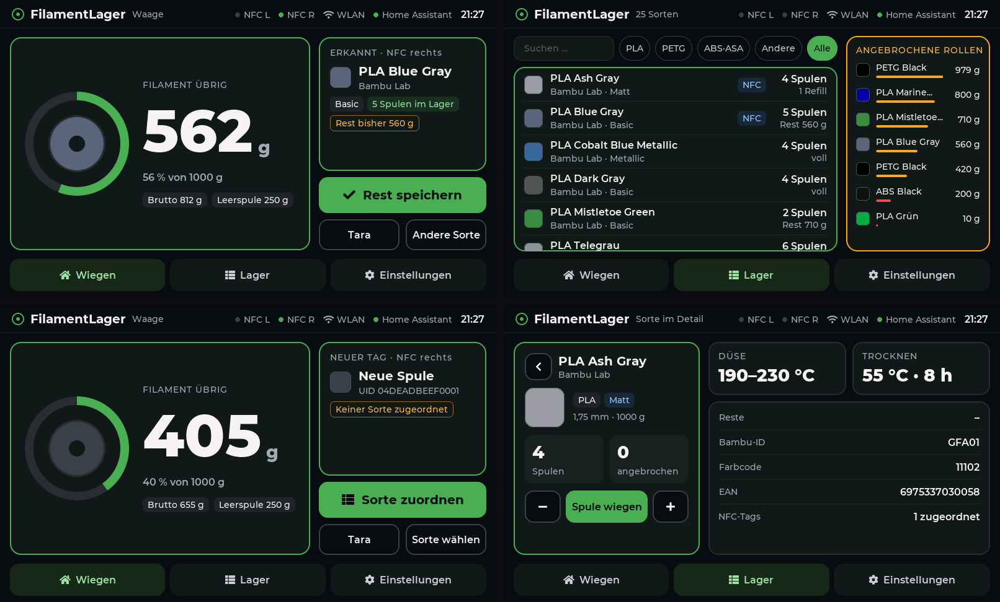
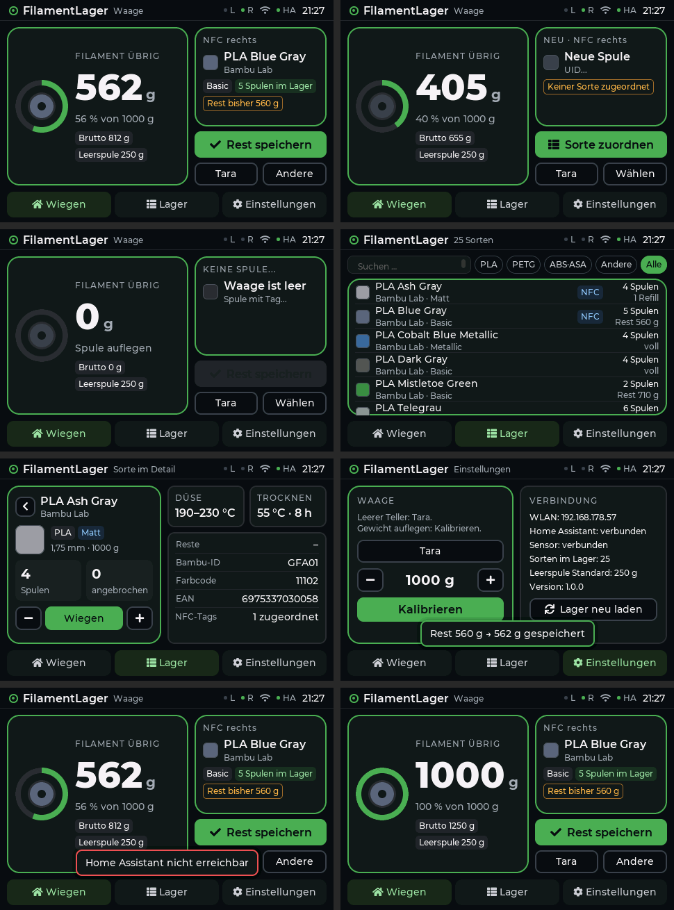

# FilamentLager-Waage (bambu-scale)

Filamentwaage mit NFC, die direkt mit dem Filamentlager **„Ernsthaft gelagert“** (`todo.filament`)
in Home Assistant arbeitet. Spule auflegen, die Waage erkennt sie am NFC-Tag, zeigt den Rest an und
trägt ihn mit einem Tipp ins Lager ein. Eigenes Design auf 800×480.



## Vier Bauarten

| | ESP32-Variante | Pi-Variante | Pad-7-Variante | Sonic-Pad-Variante |
|---|---|---|---|---|
| Display | Waveshare ESP32-S3-Touch-LCD-5 (5", 800×480) oder WT32-SC01 Plus (3,5", 480×320) | Raspberry Pi 4 + BTT PI TFT50 V2 | BTT Pad 7 mit CB1 (7", 1024×600) | Creality Sonic Pad mit SonicPad-Debian (7", 1024×600) |
| Oberfläche | LVGL, direkt auf dem ESP32 | Web-Oberfläche im Chromium-Kiosk | wie Pi-Variante | wie Pi-Variante |
| Messung | Sensorplatine (ESP32-S3-Zero) per RS485 oder WLAN | Sensorplatine per USB oder HX711/PN532 am Pi | Sensorplatine per **WLAN** – kein Kabel zum Display | wie Pad 7 |
| Ordner | `firmware/display-5inch`, `firmware/sensor-s3zero` | `pi/` | `pi/` + `pi/pad7/`, `firmware/sensor-s3zero` | `pi/` + `pi/sonicpad/`, `firmware/sensor-s3zero` |

Alle zeigen dieselben Bildschirme: **Wiegen**, **Lager** (Suche, Filter, angebrochene Rollen),
**Sorte im Detail** und **Einstellungen** (Design, WLAN, Home Assistant, Bambu Lab mit AMS-Belegung, Waage, System).

## Teile

| Anz. | Teil | ESP32 | Pi |
|---|---|---|---|
| 1 | Waveshare ESP32-S3-Touch-LCD-5 (800×480, Touch) – oder WT32-SC01 Plus (3,5") | ✓ | |
| 1 | Raspberry Pi 4 + BTT PI TFT50 V2 | | ✓ |
| 1 | Waveshare ESP32-S3-Zero-M (Sensorplatine) | ✓ | empfohlen |
| 2 | PN532 V3 mit Stiftleiste und Modusschalter | ✓ | ✓ |
| 1 | 5-kg-Wägezelle + HX711 | ✓ | ✓ |
| 1 | RS485-Modul 3,3 V (MAX3485) | ✓ | |
| 1 | Netzteil 5 V / ≥ 2 A | ✓ | ✓ (Pi-Netzteil) |

Verkabelung: [docs/VERKABELUNG.md](docs/VERKABELUNG.md)

## ESP32-Variante einrichten

**Sensorplatine ohne Installation flashen:** `FilamentLager-Webflasher.html` aus dem Branch
[`webflasher-bin`](../../tree/webflasher-bin) laden, in Chrome oder Edge öffnen, WLAN-Name und Passwort eintragen,
Platine per USB anstecken, *Verbinden und flashen*. Die Datei enthält die aktuelle Firmware und läuft offline;
GitHub Actions baut sie bei jeder Änderung an `firmware/sensor-s3zero` neu.

Voraussetzung für den Weg per Kommandozeile: [PlatformIO](https://platformio.org/install/cli).

```bash
# Sensorplatine: BOOT gedrückt halten, USB einstecken
cd firmware/sensor-s3zero
pio run -t upload

# Display
cd ../display-5inch
cp include/secrets.example.h include/secrets.h   # WLAN, HA-Adresse und Token eintragen
pio run -t upload
```

Die Sensorplatine liefert außerdem die komplette Oberfläche aus: **http://filamentwaage.local** im Browser öffnen –
am Mac, Handy oder Tablet, ganz ohne Display oder Pi.

Danach am Display: **Einstellungen → Tara** bei leerem Teller, Gewicht auflegen, **Kalibrieren**.

### Mit dem WT32-SC01 Plus (3,5")

Gleiche Firmware, eigener Treiber für ST7796 und Touch FT6336U, Oberfläche in kompakter Anordnung (480×320).
Auf dem kleinen Display fehlt nur die Seitenleiste „Angebrochene Rollen“ im Lager – die Reste stehen in der Liste.



**Ohne Installation flashen:** `FilamentLager-Webflasher-SC01Plus.html` aus dem Branch
[`webflasher-display`](../../tree/webflasher-display) laden, in Chrome oder Edge öffnen, WLAN, Home-Assistant-Adresse,
Token und – falls ohne Kabel – die IP der Sensorplatine eintragen, Display per USB anstecken, *Verbinden und flashen*.
Die Einstellungen landen im Flash des Displays; mit *Nur Einstellungen übertragen* lassen sie sich später ändern.
Für das 5"-Display gibt es dort `FilamentLager-Webflasher-Display5.html`. GitHub Actions baut beide bei jeder Änderung.

Per Kommandozeile geht es weiter so (`secrets.h` ist dann freiwillig, Vorgaben für den ersten Start):

```bash
cd firmware/display-5inch
pio run -e sc01plus -t upload
```

- **Sensorplatine per RS485:** Die RS485-Buchse ist auf dem SC01 Plus schon drauf, an der Sensorplatine braucht es das
  MAX3485-Modul (Verkabelung: [docs/VERKABELUNG.md](docs/VERKABELUNG.md#wt32-sc01-plus--sensorplatine)).
- **Oder per WLAN, ganz ohne Kabel:** im Webflasher „Sensorplatine: per WLAN“ und die IP der Sensorplatine.
  Die Sensorplatine bedient nur eine WLAN-Gegenstelle – Pad 7 oder Pi dann nicht gleichzeitig per WLAN verbinden.
- Bild gedreht oder Touch daneben: `LCD_DREHUNG`, `TOUCH_SPIEGEL_X/Y` und `LCD_IPS` in `include/config.h`;
  der serielle Monitor zeigt die Touch-Rohwerte.

## Pi-Variante einrichten

Raspberry Pi OS Bookworm auf dem Pi 4 – mit oder ohne Desktop (Lite), dann:

```bash
git clone https://github.com/MitKIprogrammieren/bambu-scale
cd bambu-scale/pi
./install.sh --wlan     # Sensorplatine per WLAN wie beim Pad 7; --wlan=192.168.1.50 für eine feste IP
nano /etc/filamentwaage/config.toml   # Home-Assistant-Adresse und Token eintragen
sudo systemctl restart filamentwaage
sudo reboot
```

Weitere Optionen: `--gpio` für PN532/HX711 direkt am Pi, `--tft50` falls das Display dunkel bleibt.
Ohne Desktop startet die Oberfläche wie beim Pad 7 über einen eigenen X-Server auf tty1
(`filamentwaage-kiosk.service`), mit Desktop nach dem Anmelden im Vollbild. Eine frühere
Pi-Version (SpoolmanScaleatPi, Dienst `spoolmanscale`) schaltet der Installer ab; sie bleibt installiert.
Aktualisieren: `cd ~/bambu-scale && git pull && cd pi && ./install.sh --wlan`. Ohne Hardware ausprobieren:
`art = "demo"` in der Konfiguration – dann laufen Testszenen mit Testdaten.

Auch am PC (Python 3.11+): `cd pi && python3 -m filamentwaage demo.toml`, dann
http://127.0.0.1:8080 im Browser öffnen.

## Etiketten drucken (Phomemo)

Pi- und Pad-7-Variante drucken Etiketten auf einem Phomemo-Etikettendrucker (M110/M220/M20-Familie)
per Bluetooth: in der Sorte **Etikett drucken** oder beim Wiegen das Drucker-Symbol – dann steht der
gewogene Rest mit auf dem Etikett.

- Formate: Classic 40×30, Expanded 50×30, Compact 40×25, Vertikal 30×40 mm, gedruckt mit 203 dpi in Schwarz-Weiß
- Inhalt: Hersteller, Material, Farbe mit Farbcode und Hex-Wert, Düse/Bett/Flow/TD, Rest und ein QR-Code zum Lager in Home Assistant
- Einrichten: **Einstellungen → Etiketten → Drucker suchen**, Drucker antippen, **Testdruck**
- Herstellerbild statt Name: pro Hersteller in der Waage hochladen oder in [`pi/hersteller/`](pi/hersteller/LIESMICH.md) ablegen

Das Etikett wird in der Oberfläche gezeichnet (`web/etikett.js`), der Dienst schickt das Raster an den
Drucker (`phomemo.py`). Ohne Drucker testen: `verbindung = "datei"` in `[etikett]`.

## Pad-7-Variante einrichten

Das Pad 7 ist nur Bildschirm, die Sensorplatine in der Waage funkt per WLAN.
Schritt für Schritt: [pi/pad7/ANLEITUNG.md](pi/pad7/ANLEITUNG.md).

**Fertiges Image:** `FilamentLager-Pad7.img.xz` unter *Releases* flashen, auf der Partition BOOT WLAN
(`system.cfg`) und HA-Token (`filamentwaage/config.pad7.toml`) eintragen, einschalten – das Pad 7 richtet sich
beim ersten Start selbst ein. Gebaut mit `tools/pad7_image.sh` (braucht [pyfatfs](https://github.com/nathanhi/pyfatfs)).

Ohne fertiges Image:

1. Sensorplatine flashen, über das WLAN **FilamentWaage-Setup** ins Heimnetz bringen. Test: http://filamentwaage.local im Browser.
2. BTT-CB1-Image (Klipper-Version) auf die SD-Karte, WLAN in `system.cfg` eintragen.
3. `tools/pad7_paket.sh` baut `filamentwaage-pad7.zip` – den Ordner daraus auf die Partition BOOT kopieren,
   Token in `config.pad7.toml` eintragen.
4. Am Pad 7 einmal `sudo bash /boot/filamentwaage/install-pad7.sh` – danach startet es direkt in die Waage.

## Sonic-Pad-Variante einrichten

Wie das Pad 7 ist das Sonic Pad nur Bildschirm. Auf die Creality-Firmware passt kein Browser, daher kommt zuerst
[SonicPad-Debian](https://github.com/Teichoui/SonicPad-Debian) per PhoenixSuit aufs Pad.
Schritt für Schritt: [pi/sonicpad/ANLEITUNG.md](pi/sonicpad/ANLEITUNG.md).

1. SonicPad-Debian flashen, in KlipperScreen WLAN verbinden.
2. `tools/sonicpad_paket.sh` baut `filamentwaage-sonicpad.zip`, per `scp` aufs Pad (`sonic` / `pad`).
3. Auf dem Pad entpacken und `sudo bash filamentwaage/install-sonicpad.sh --waage=<IP der Waage>` – danach startet es direkt in die Waage.

## Nur Sensorplatine, Bedienung im Browser

Ohne Display und ohne Pi: Die Sensorplatine (ESP32-S3-Zero) liefert die komplette Oberfläche selbst aus.

1. `FilamentLager-Webflasher.html` (Branch `webflasher-bin`) in Chrome öffnen, WLAN eintragen, *Verbinden und flashen*.
2. **http://filamentwaage.local** oder die angezeigte IP öffnen – am Mac, Handy oder Tablet.
3. *Einstellungen → Home Assistant*: Adresse und Token eintragen, *Speichern*.

Etiketten und die AMS-Anzeige gibt es in dieser Bauart nicht.

## Home Assistant

- Langlebiges Zugriffstoken anlegen: HA → Profil → Sicherheit → *Langlebige Zugriffstokens*.
- Die Waage braucht nur die Dienste `todo.get_items` und `todo.update_item` für `todo.filament`.
- Was genau geschrieben wird: [docs/LAGER.md](docs/LAGER.md)

## Entwicklung und Tests

```bash
# Python (Pi): Modell, HA-Anbindung
cd pi && python3 -m unittest discover -s tests

# ESP32-Oberfläche am PC rendern, 800×480 und 480×320 (braucht LVGL 8.3 und ArduinoJson 7 als Quellen)
firmware/display-5inch/test/host/build.sh /pfad/zu/deps ausgabe/

# Schriften neu erzeugen (nach Änderung der Zeichen)
python3 tools/gen_lvgl_fonts.py <Montserrat-ttf-Ordner> firmware/display-5inch/src/fonts
```

Das Datenmodell existiert zweimal – `firmware/display-5inch/src/model.cpp` und
`pi/filamentwaage/modell.py` – mit denselben Regeln und denselben Testfällen.

Protokoll der Sensorplatine: [docs/PROTOKOLL.md](docs/PROTOKOLL.md)

## Stand

| Teil | Geprüft |
|---|---|
| Datenmodell C++ und Python | Tests mit echten Lagerdaten |
| ESP32-Oberfläche (5" und SC01 Plus) | am PC mit LVGL 8.3 gerendert |
| SC01-Plus-Firmware | auf echtem SC01 Plus: Display, Touch und Einrichtung per Webflasher laufen |
| Pi-Dienst und Web-Oberfläche | im Demo-Modus und gegen nachgebautes Home Assistant |
| WLAN-Verbindung Pi/Pad 7 ↔ Sensorplatine (Python) | Tests gegen nachgebaute Sensorplatine |
| ESP32-Display-Treiber (5" und SC01 Plus), Touch, WLAN, Sensor-Firmware | **noch nicht auf echter Hardware** – Pins und Display-Timing beim ersten Start prüfen |
| Pad-7-Installation (CB1) | **noch nicht auf echter Hardware** |

## Schrift

Montserrat, SIL Open Font License 1.1 (`OFL.txt` neben den Schriftdateien).
